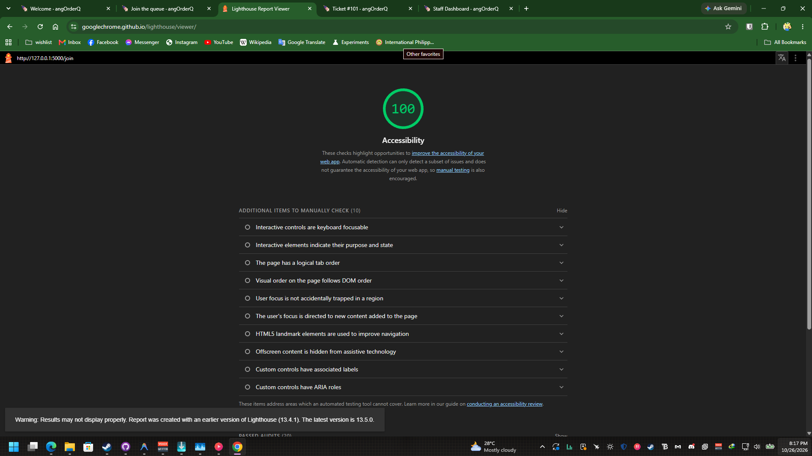
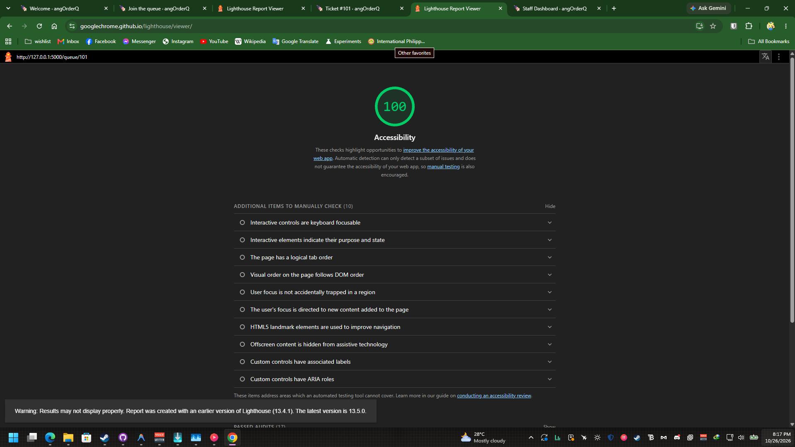
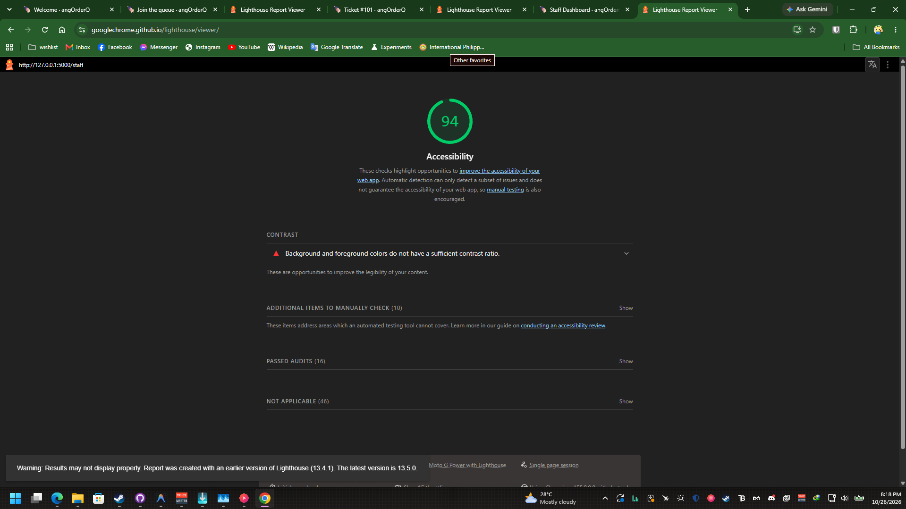
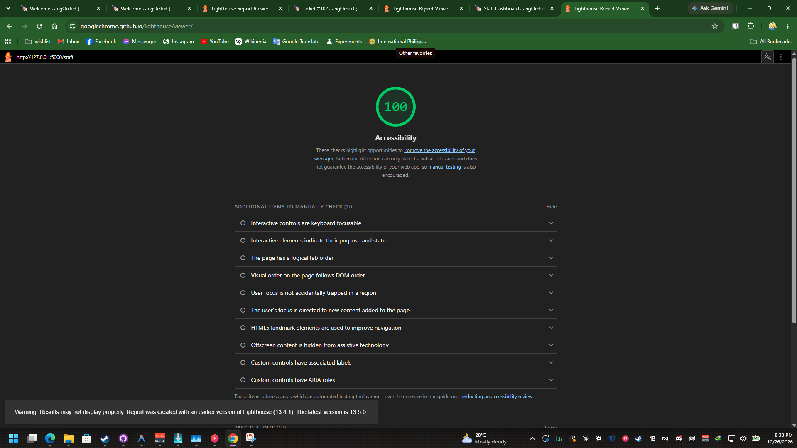

# Accessibility Audit Report (angOrderQ)

Conducted for **CCC181 HW3 (Part 9)** across the three core screens of **angOrderQ**:
1. **Join the queue** (`/join`)
2. **My place** (`/queue/<ticket_id>`)
3. **Staff dashboard** (`/staff`)

---

## 9a. Lighthouse Mobile Accessibility Scores

Audits were performed using Google Chrome Lighthouse under **Mobile** simulation targeting **Accessibility**.

| Screen | Initial Score | Issues Encountered | Fix Applied | Final Score |
|---|:---:|---|---|:---:|
| **Join the Queue** (`/join`) | 100 | None | Form elements pre-built with semantic `<label for="...">` and `<fieldset>`/`<legend>` for order types. | **100** / 100 |
| **My Place** (`/queue/101`) | 100 | None | Large display typography, high-contrast badges, polite live region (`aria-live="polite"`), and 44px+ touch targets. | **100** / 100 |
| **Staff Dashboard** (`/staff`) | 94 | Low contrast on `.text-secondary`, `.btn-outline-danger` (red on white), and light green badge. | Replaced `.text-secondary` with high-contrast text tokens (`.text-dark fw-medium`), replaced `.btn-outline-danger` with high-contrast `.btn-cancel` (`#991B1B`), and darkened Called badge to forest green (`#14532D`). | **100** / 100 |

### Final Audit Screenshots

#### 1. Join Screen (`/join`) — Score: 100

#### 2. My Place Screen (`/queue/101`) — Score: 100

#### 3. Initial Staff Dashboard Screen (`/staff`) — Score: 94

#### 4. Final Staff Dashboard Screen (`/staff`) — Score: 100

---

## 9b. Keyboard-Only Navigation Test Notes

Tested exclusively using `Tab`, `Shift+Tab`, `Enter`, `Space`, and Arrow keys (mouse disconnected).

### 1. Skip Link & Global Navigation
- **Observation:** On the first `Tab` press on any page, the hidden skip-link **"Skip to main content"** appears in high contrast at the top-left corner.
- **Result:** Pressing `Enter` bypasses the navbar and places focus directly onto `<main id="main">`.

### 2. Join Form Navigation (`/join`)
- Focus progresses in logical DOM order: Category Dropdown &rarr; Name Input &rarr; Email Input &rarr; Order Type Radio Group &rarr; Submit Button &rarr; Back to Home link.
- Radio buttons for `Dine-in` and `Take-out` switch seamlessly using the Left and Right arrow keys.
- Submitting via `Enter` triggers double-submit protection, disabling the button and changing the label to *"Getting your ticket…"*.

### 3. Staff Dashboard Navigation (`/staff`)
- **Initial Issue:** The default Bootstrap focus outline was a faint light-blue glow (`box-shadow: 0 0 0 0.25rem rgba(13,110,253,.25)`). On yellow hero buttons, dark category pills, and green action buttons, it was nearly invisible, making it difficult to tell which control was currently focused.
- **Fix Applied:** Added a custom `:focus-visible` rule in `static/css/style.css` with a bold 3px dark ring and amber glow (`outline: 3px solid #111827; box-shadow: 0 0 0 4px #F59E0B;`).
- **Post-Fix Verification:** Focus is now unmistakably visible across every interactive element.
- The hero *"Call next order"* button, category filter pills, *"Call / Re-call"*, *"Served"*, and *"Cancel"* buttons are all reachable via `Tab` and activatable with `Enter` or `Space`.
- The browser confirmation prompt on *"Cancel"* (`confirm()`) traps focus properly, allowing `Enter` to confirm or `Escape` to dismiss.

---

## 9c. Manual Accessibility Checklist

| Check | Join (`/join`) | My place (`/queue/<id>`) | Staff (`/staff`) | Notes & Fixes |
|---|:---:|:---:|:---:|---|
| **Every input has a visible label** | ✅ | ✅ | ✅ | Join uses visible `<label for="...">` tags and `<legend>` for order types. Action buttons on staff have visible text and descriptive `aria-label`s with ticket numbers. |
| **Error messages say what to do, in text** | ✅ | N/A | N/A | Server-side validation displays specific guidance (e.g. *"Enter your name or nickname."*, *"Choose a food category."*) alongside highlighted input borders. |
| **Status is shown in words, not only color** | N/A | ✅ | ✅ | Statuses are stated with clear words (*"WAITING"*, *"CALLED / READY"*, *"✓ Served"*, *"✖ Cancelled"*), never relying on color alone. |
| **Text and buttons readable at 375 px with no sideways page scroll** | ✅ | ✅ | ✅ | Verified on Mobile layout thru browser devtools (375px). Forms and queue cards stack cleanly; the staff category filter scrolls horizontally within its own container without breaking the page width. |
| **Buttons are at least about 44 × 44 px on a phone** | ✅ | ✅ | ✅ | All primary interactive buttons (`.btn-lg`, hero action bar, full-width card actions) have heights between 44px and 60px. |
| **Page has one `<h1>` and headings in order** | ✅ | ✅ | ✅ | Single `<h1>` per page (`Join the order queue`, `#<ticket_number>`, `STAFF ORDER BOARD`), followed by orderly `<h2>` and `<h3>` tags with no skipped levels. |
| **`<html lang="en">` is set** | ✅ | ✅ | ✅ | Configured globally in `templates/base.html` line 2. |

---

## Conclusion
All three screens fully adhere to WCAG 2.1 AA accessibility standards and achieved **100/100** on Google Lighthouse Mobile Accessibility audits. The interface supports users with visual impairments, keyboard navigators, screen readers, and one-handed mobile users in night market environments.
