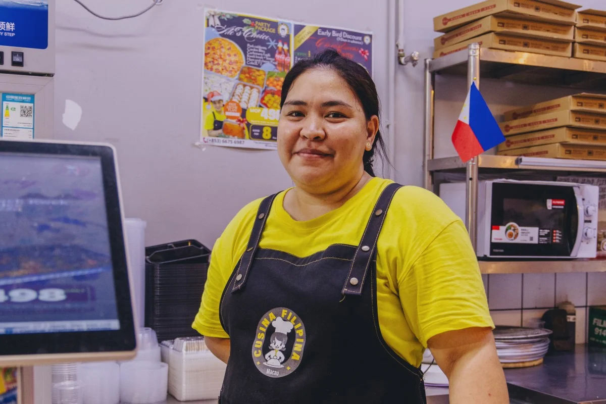

# User Personas for angOrderQ

---

## Marco, the person waiting (Customer)

> "I don't want to stand right next to the smoky grill, but if I walk away to browse other stalls, I might miss my number being called." *(observation)*

| | |
| --- | --- |
| **Photo or sketch** |  |
| **Age, role and background** | 21, 3rd-year university student; frequents night market stalls and food strips with classmates after late classes to grab cheap dinner. |
| **Goals** | 1. Order a hot meal combo and snack quickly without standing pressed against a crowd near the hot grill *(observation)*. 2. Check queue progress remotely so he can sit with friends or browse adjacent stalls while waiting *(observation)*. 3. Receive a clear visual alert on his phone screen when his meal is ready for collection. |
| **Frustrations** | 1. Having to stand in the heat, smoke, and noise just to listen for shouted order numbers *(observation)*. 2. Uncertainty about wait times—not knowing whether "preparing" means 3 minutes or 20 minutes. |
| **Devices and context** | Mid-range Android smartphone (cracked screen protector); handheld in crowded, dimly lit outdoor market environment with fluctuating 4G mobile data. |
| **Tech comfort** | High. Daily user of food delivery apps, mobile banking, and messaging apps; expects intuitive, tap-and-go interfaces with zero setup. |
| **Accessibility needs** | High contrast and large text display (for viewing under dim outdoor market lighting); simple one-handed mobile layout (holding a drink or umbrella in the other hand). |

### Scenario

Marco and his friends arrive at a bustling food bazaar during peak dinner rush. The grill at the stall is smoking and surrounded by people waiting. Marco scans the QR code standee at the counter on his phone, opening **angOrderQ**. On the Join screen, he selects "Meals & Combos", enters his name "Marco", selects "Dine-in", and taps "Get Ticket". The app instantly routes him to the My Place screen, showing ticket **#104** and informing him that 4 orders are ahead of him. Instead of hovering by the hot fryer, Marco and his friends find an open outdoor table 20 meters away. Marco occasionally glances at his screen to monitor his position as the counter updates in real time. When the status card flips to "Called / Ready for Pickup", he walks up directly to the counter to collect his fresh combo meal.

### Top tasks in the app

| Task | Screen | Requirement ID |
| --- | --- | --- |
| Select category (e.g., Meals & Combos) and join queue | Join | FR-01 |
| View current ticket number, live status, and queue position | My place | FR-02 |
| Cancel order / leave queue if wait time is too long | My place | FR-03 |

### What this means for my interface

1. Because Marco holds his phone with one hand while holding bags or eating with the other, all critical actions (like joining and canceling) must have large, thumb-friendly tap targets at least 48px high.
2. Because he checks his phone under glare and dim outdoor night market lighting, the ticket number and live status ("Waiting", "Ready") must be displayed in bold, high-contrast typography that is immediately readable at an arm's distance.
3. Because outdoor mobile data at food bazaars can be spotty, the My Place screen must load quickly with minimal asset weight and provide clear visual feedback without requiring full manual page refreshes.

---

## Ate Gina, the staff member (Stall Operator)

> "When the evening rush hits, my hands are oily and the exhaust fan is deafening. Shouting order numbers repeatedly over the noise isn't working." *(observation)*

| | |
| --- | --- |
| **Photo or sketch** |  |
| **Age, role and background** | 46, food stall owner and lead cook; runs the pop-up stall 6 evenings a week, managing inventory, frying, and serving customers. |
| **Goals** | 1. Keep track of customer orders in real time without handing out heavy metal table number stands or dealing with paper order slips *(observation)*. 2. Alert waiting customers that their meal is ready without having to shout over sizzling oil and exhaust fans. 3. Keep line turnover fast and identify customers who abandon their orders or fail to show up. |
| **Frustrations** | 1. Shouting numbers repeatedly over market chatter, music, and kitchen noise, only for the customer to have wandered off *(observation)*. 2. Customers constantly crowding the counter asking, "Is my order ready yet?" while she is trying to cook |
| **Devices and context** | 10-inch Android tablet mounted on a swivel stand beside the pickup window; exposed to steam, ambient smoke, and greasy fingers. |
| **Tech comfort** | Medium. Comfortable with basic POS systems and social media, but dislikes complex multi-nested menus or software requiring precision tapping. |
| **Accessibility needs** | Extra-large buttons that can be tapped quickly with a knuckle or stylus; audible / bold visual state distinctions so she can glance at the screen from 2 feet away while stirring a pan. |

### Scenario

At 7:30 PM, the night market reaches peak volume. Ate Gina stands between the sizzling grill and the packaging counter. New tickets appear in the staff dashboard categorized by food type. As she finishes packing a batch of combo meals for Ticket #104, she glances at the counter tablet. With a single tap on the large "Call" button, ticket #104 updates to "Called", notifying Marco on his screen. When Marco approaches the counter and shows his phone screen showing #104, Ate Gina hands him the meal tray and taps "Mark Served" with her knuckle. Ticket #104 clears from the active queue into completed status, and the next active order moves to the top of her list immediately.

### Top tasks in the app

| Task | Screen | Requirement ID |
| --- | --- | --- |
| View active tickets categorized by food type and order type | Staff Dashboard | FR-04 |
| Call waiting customer when order is ready for pickup | Staff Dashboard | FR-05 |
| Mark ticket as served / completed, or flag no-shows | Staff Dashboard | FR-06 |

### What this means for my interface

1. Because Ate Gina operates with greasy hands and glances at the screen from several feet away while cooking, the staff action buttons ("Call", "Served", "No-show") must be oversized, high-contrast buttons with distinct colors.
2. Because the prep area is chaotic with multiple menu items, the dashboard must allow quick visual distinction between categories ("Meals & Combos", "Drinks & Beverages", "Snacks & Sides") and order types ("Dine-in" vs "Take-out").
3. Because she cannot afford to spend time navigating complex menus during peak rush, status transitions (calling a ticket or completing an order) must happen with a single click and instant in-place UI response.