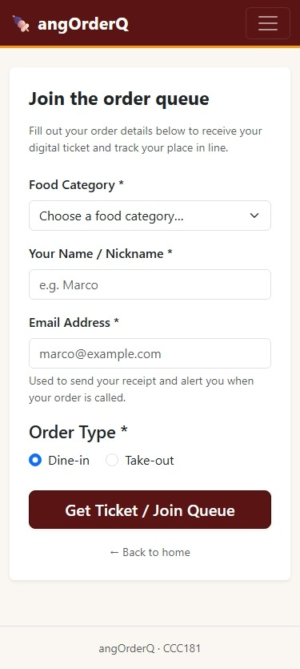
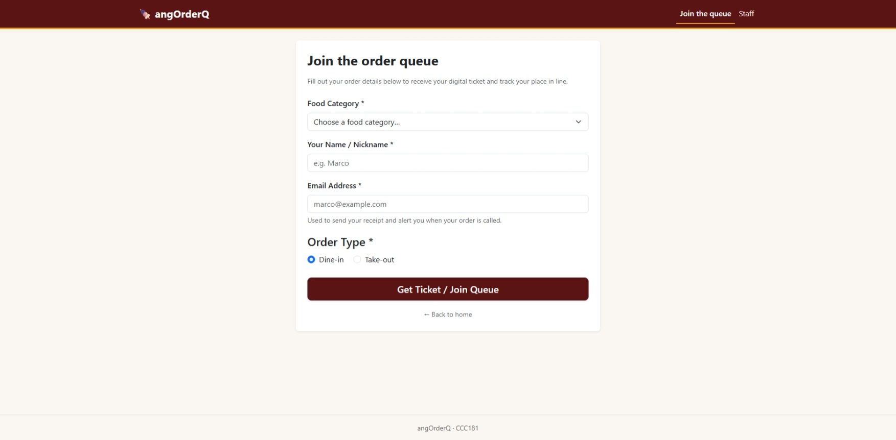
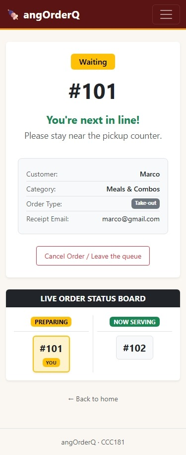
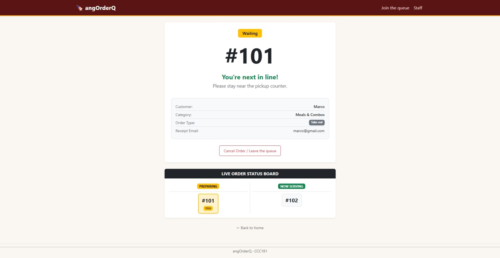
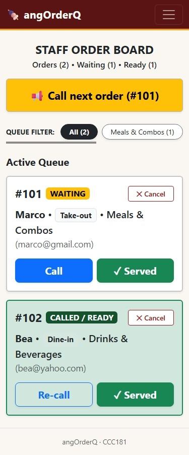
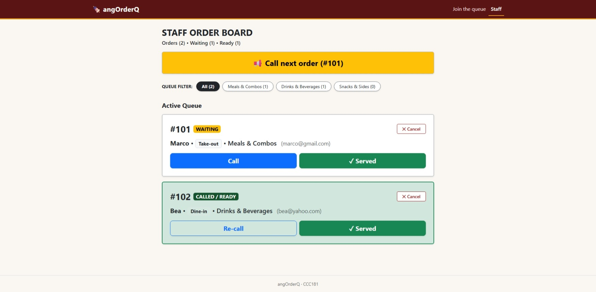

# Week 3 Report: First Working Interface for angOrderQ

## 1. Title Details
- **App Name:** angOrderQ
- **Setting:** Pop-up Food Stalls & Night Market Vendors
- **Student Name:** Yaseen P. Smith
- **Student ID:** 2024-1729
- **Section:** CS3A
- **Date:** October 26, 2026
- **Pull Request Link:** [Pull Request #2: Week 3 First Interface](https://github.com/ysnsmthiit/CCC181_Smith/pull/2)

---

## 2. Personas
Our interface is grounded in two primary user personas:
1. **Marco (Customer Waiting):** A 21-year-old student who wants to order hot food quickly without standing in smoky crowds near hot fryers.
   - *Quote:* *"I don't want to stand right next to the smoky grill, but if I walk away to browse other stalls, I might miss my number being called."*
   - *Top Tasks:* Select food category & place order (`FR-01`), track live ticket progress & claim monitor (`FR-02`), cancel order if wait is too long (`FR-03`).
2. **Ate Gina (Stall Operator):** A 46-year-old lead cook operating a tablet on a swivel stand amid kitchen steam and greasy fingers.
   - *Quote:* *"When the evening rush hits, my hands are oily and the exhaust fan is deafening. Shouting order numbers repeatedly over the noise isn't working."*
   - *Top Tasks:* View active orders categorized by food type (`FR-04`), call customer when food is packed (`FR-05`), mark order as served upon counter pickup (`FR-06`).

Full user profiles, scenarios, and design constraints are detailed in [docs/week3/personas.md](personas.md).

---

## 3. Screens

### 1. Join the Queue (`/join`)
- **Phone Width (375px):** 
- **Laptop Width:** 
- *Usage:* Used by **Marco** to place an order, select a food category, and choose packaging (`Dine-in` vs `Take-out`) covered by requirement **FR-01**.

### 2. My Place (`/queue/<id>`)
- **Phone Width (375px):** 
- **Laptop Width:** 
- *Usage:* Used by **Marco** to view his ticket number in large typography, monitor orders ahead, and track the live claim board covered by requirements **FR-02** and **FR-03**.

### 3. Staff Dashboard (`/staff`)
- **Phone Width (375px):** 
- **Laptop Width:** 
- *Usage:* Used by **Ate Gina** to monitor the incoming queue, filter by menu categories, call orders, and complete sales covered by requirements **FR-04**, **FR-05**, and **FR-06**.

---

## 4. Design Decisions
1. **Card-Based Queue Layout on Staff Dashboard:** Instead of a generic data spreadsheet, we adopted touch cards with 48px+ action buttons. This accommodates Ate Gina operating a tablet with greasy hands while cooking, allowing single-tap operations without misclicks.
2. **High-Contrast Display & Jollibee-Style Claim Board on My Place:** We placed the ticket number in extra-large `display-1` bold font accompanied by a 2-column live status monitor (*Preparing* vs *Now Serving*) with a bright yellow `YOU` badge, ensuring Marco can check his status at an arm's length under dim night market lighting.
3. **Double-Submit Prevention with Immediate Text Feedback:** On the join form, submitting instantly disables the trigger and updates the label to *"Getting your ticket…"*, preventing impatient mobile taps on spotty market Wi-Fi from producing duplicate orders.

---

## 5. Self-Review
From our initial wireframes reviewed in [docs/week3/feedback.md](feedback.md), three core improvements were made:
- **Join Screen:** Made email strictly optional for receipts to remove ordering friction for hungry walk-in customers.
- **My Place Screen:** Added a high-contrast status badge and live position sentence directly above the claim monitor to eliminate ambiguity.
- **Staff Dashboard:** Replaced cluttered secondary tags with clean category filter pills (*Meals & Combos*, *Drinks & Beverages*, *Snacks & Sides*) and boosted button heights to 48px+.

---

## 6. Accessibility
- **Lighthouse Mobile Scores:** Achieved **100 / 100** on Join, **100 / 100** on My Place, and **100 / 100** on the Staff Dashboard.
- **Most Important Fix:** On the Staff Dashboard, initial Lighthouse audits scored 94 due to low contrast on `.text-secondary` and `.btn-outline-danger`. We replaced light greys with high-contrast text tokens, created `.btn-cancel` (`#991B1B`, passing AAA contrast), deepened Called badges to forest green, and added custom `:focus-visible` outlines (3px dark ring with amber glow) for keyboard navigators.
- Detailed audit logs and checklist are archived in [docs/week3/accessibility.md](accessibility.md).

---

## 7. Usability Test & Improvement
- **User Test:** Conducted with a 23-year-old medical student (sister) representing the customer persona Marco.
- **Task Summary:** Task 1 (Order drink via form) completed in ~25s without help; Task 2 (Read ticket number & position) completed in ~8s without help; Task 3 (Call & serve orders on staff board) completed in ~30s with minor status clarification.
- **Key Improvement:** Resolved a live claim board synchronization bug where called tickets updated on the top banner but remained stuck in the *Preparing* column on the claim board. We expanded the status JSON payload and client polling logic so tickets jump to *Now Serving* in real time without refreshing.
- Detailed observations and before/after screenshots are documented in [docs/week3/usability-test.md](usability-test.md).

---

## 8. Reflection
- **What Was Hardest:** Managing client-server state coordination using purely in-memory Python dictionaries and asynchronous fetch polling without full-duplex WebSockets. Ensuring that status updates reliably updated both personal cards and public claim boards without triggering full page reloads required disciplined DOM structuring.
- **Transition to Week 4 Database:** In Week 4, moving tickets from an ephemeral Python list to PostgreSQL will eliminate data loss on server restarts, allow robust ticket status indexing, and support concurrent multi-device kitchen operations.

---

## 9. Declaration
All personas, wireframes, domain architecture, usability tests, and design choices were created and conducted independently. 

I consulted **Google Antigravity (Gemini)** as a reference and debugging assistant for:
- Looking up Bootstrap 5 utility classes and WCAG contrast values during accessibility auditing.
- Syntax reference for client-side asynchronous `fetch()` polling and event listeners.
- Troubleshooting IDE linter warnings on Jinja template expressions.
