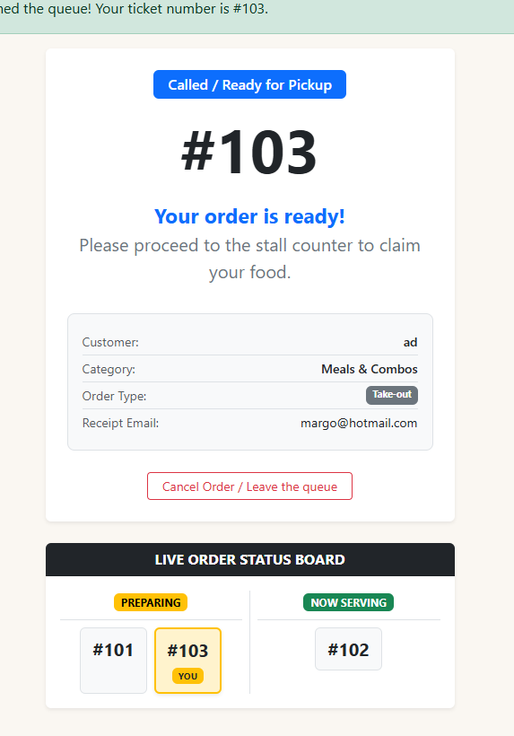
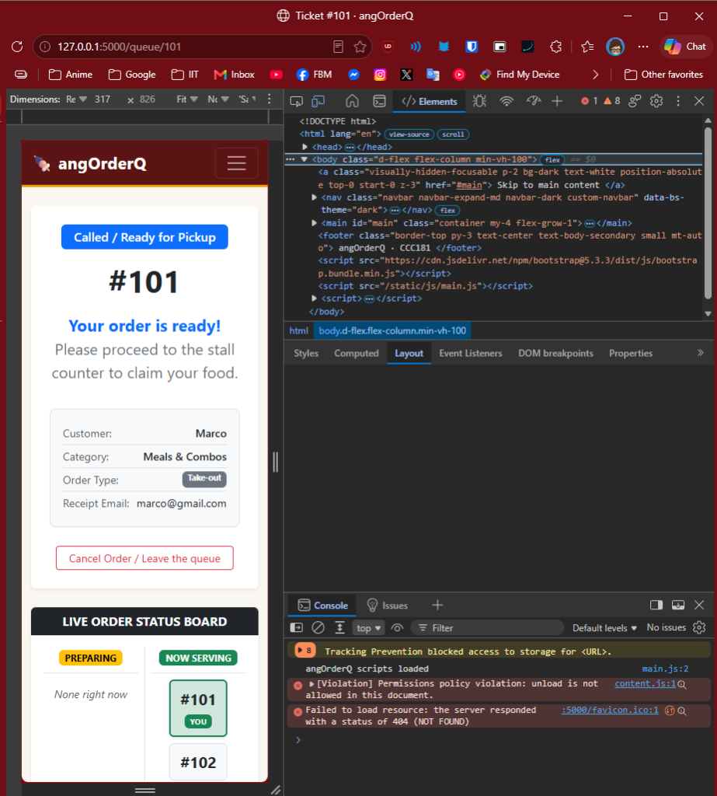

# Usability Test & Interface Improvement (angOrderQ)

Conducted for **CCC181 HW3 (Part 10)** on the `feature/week3-interface` branch.

---

## 10a. Usability Test with a Real User

### Participant Profile
- **Participant:** Sister ( 23 years old, medical student).
- **Match to Persona:** Matches the primary customer persona (**Marco**) — frequent night bazaar and food strip customer who values quick ordering on mobile without standing in crowded stall areas.
- **Testing Device:** Desktop laptop running the web application at `http://127.0.0.1:5000/`.

---

### Task Results

#### Task 1: "You just arrived. Get in line for one of the food categories."
- **Finished:** Yes (without help)
- **Time Taken:** ~25 seconds
- **Observations & Quotes:** 
  - Clicked *"Join the queue"* on the homepage immediately.
  - Read through the dropdown options aloud: *"Meals & Combos, Drinks & Beverages, Snacks & Sides."*
  - Hesitated briefly on what to crave, remarking: *"I want to eat... No, I want a drink actually."* Switched her selection to *Drinks & Beverages*.
  - Typed her nickname *"Junaniol"* and email.
  - Selected *"Take-out"* on the radio buttons and clicked *"Get Ticket / Join Queue"*.
- **Persona Rule Check:** 
  - *Rule:* Single-column stacked form with clear food categories for quick ordering.
  - *Verdict:* **Held up.** The category dropdown and straightforward inputs allowed her to place an order in under 30 seconds with zero confusion.

#### Task 2: "What is your ticket number and how many people are ahead of you?"
- **Finished:** Yes (without help)
- **Time Taken:** ~8 seconds
- **Observations & Quotes:**
  - Read her ticket number out loud immediately: *"My ticket number is 103."*
  - Looked at the Live Order Status Board below showing `#101` and `#103 [YOU]` under Preparing, and noted: *"And there is one person ahead of me."*
- **Persona Rule Check:**
  - *Rule:* High visual hierarchy and large typography readable at an arm's distance.
  - *Verdict:* **Held up.** The prominent `display-1` ticket number and the yellow `YOU` badge made recognizing her order status effortless.

#### Task 3: "Pretend you are Ate Gina cooking at the stall. Go to Staff in the navbar. Call the next person and mark them as served."
- **Finished:** Yes (with minor clarification on already-called status)
- **Time Taken:** ~30 seconds
- **Observations & Quotes:**
  - Clicked *"Staff"* in the navbar.
  - Reviewed the active queue cards. Saw ticket `#102` was in `CALLED / READY` state and asked: *"Do I have to re-call this?"* (Clarified that `#102` was already called, so she clicked *"✓ Served"* to clear it).
  - Spotted her own order `#103` in the queue and exclaimed: *"And then it's mine! Call!"*, tapping *"Call"*.
  - Watched the status badge flip to `CALLED / READY`, then tapped *"✓ Served"*.
  - Proceeded to serve remaining ticket `#101` until the screen cleanly displayed the *"All caught up!"* empty state.
- **Persona Rule Check:**
  - *Rule:* Large, high-contrast action triggers for fast one-tap stall operations.
  - *Verdict:* **Held up.** Oversized buttons (`Call`, `Re-call`, `✓ Served`) provided clear tap targets and gave instant feedback without page misclicks.

---

## 10b. Interface Improvement: Real-Time Claim Board Synchronization

### Problem Description
During testing of the 10-second background polling behavior (Part 8b), when a staff member marked a ticket as *Called / Ready for Pickup*, the customer's top card updated correctly to *"Your order is ready!"*. 

However, the **Live Order Status Board** at the bottom of the screen did not update. Ticket `#103 [YOU]` remained stuck in the **Preparing** column, while the **Now Serving** column did not show the called ticket until a manual browser refresh occurred. This created conflicting visual feedback: the top banner claimed the order was ready, but the claim monitor below still said it was preparing.

### The Fix
1. **Server (`app.py`):** Updated the `@app.get("/queue/<ticket_id>/status.json")` route to return active `waiting_numbers` and `called_numbers` lists alongside personal status.
2. **Client (`templates/ticket.html`):** Added container IDs (`#board-preparing` and `#board-called`) and expanded `refreshStatus()` to dynamically re-render the claim blocks. When a ticket is called, `#103 [YOU]` smoothly transitions into the **Now Serving** column automatically without a full page reload.

### Evidence (Before and After)

| Before Fix | After Fix |
|:---:|:---:|
| *(Top card shows Called, but Claim Board below still shows `#103 [YOU]` stuck in Preparing)* | *(Top card shows Called, and `#101 [YOU]` has moved into Now Serving in real time)* |
|  |  |
