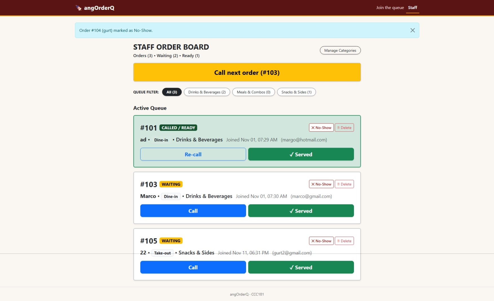
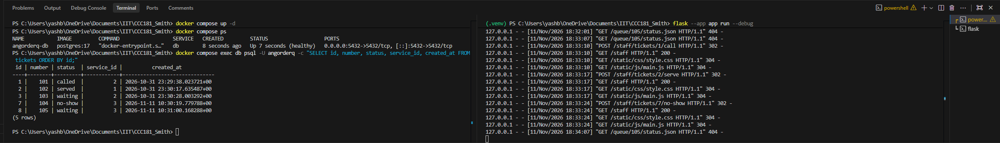
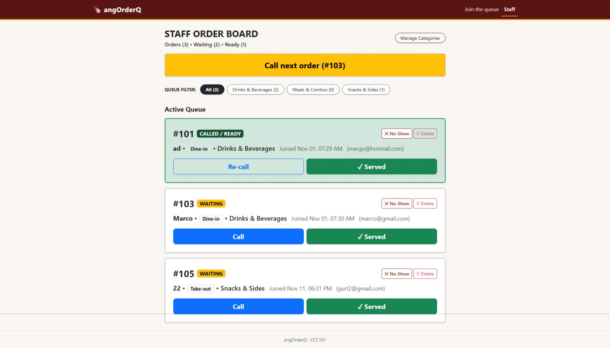
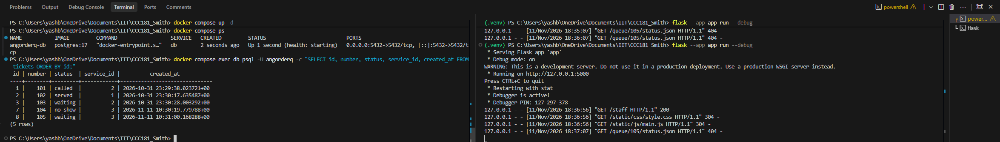

# Persistence Verification: angOrderQ

## 1. The Restart Test (Part 11a)

**Requirement Tested:** `NFR-01` — *No ticket is lost when the server or the database restarts.*

### Test Procedure
1. Created multiple tickets across different food categories (*Meals & Combos*, *Drinks & Beverages*, *Snacks & Sides*).
2. Performed lifecycle state transitions from the Staff Order Board:
   - Called Ticket `#101` (status changed to `called`, setting `called_at`).
   - Marked Ticket `#102` as served (status changed to `served`, setting `served_at`).
   - Marked Ticket `#104` as no-show (soft delete transition).
   - Left Tickets `#103` and `#105` in `waiting` status.
3. Queried PostgreSQL via `psql` to capture the database rows and timestamps before shutdown.
4. Stopped the Flask server (`Ctrl+C`) and shut down the Docker container (`docker compose down`).
5. Verified with `docker compose ps` that no containers were running.
6. Brought the container back up with `docker compose up -d`, verified health status, and restarted Flask.
7. Re-queried PostgreSQL and refreshed the Staff Order Board.

---

### Before Restart

#### Staff Order Board (Browser)


#### Terminal & SQL State (psql)


```sql
SELECT id, number, status, service_id, created_at FROM tickets ORDER BY id;
```
```
 id | number | status  | service_id |          created_at           
----+--------+---------+------------+-------------------------------
  1 |    101 | called  |          2 | 2026-10-31 23:29:38.023721+00
  2 |    102 | served  |          1 | 2026-10-31 23:30:17.635487+00
  3 |    103 | waiting |          2 | 2026-10-31 23:30:28.003292+00
  7 |    104 | no-show |          3 | 2026-11-11 10:30:19.779788+00
  8 |    105 | waiting |          3 | 2026-11-11 10:31:00.168288+00
(5 rows)
```

---

### After Restart

#### Staff Order Board (Browser)


#### Terminal & SQL State (psql)


```sql
SELECT id, number, status, service_id, created_at FROM tickets ORDER BY id;
```
```
 id | number | status  | service_id |          created_at           
----+--------+---------+------------+-------------------------------
  1 |    101 | called  |          2 | 2026-10-31 23:29:38.023721+00
  2 |    102 | served  |          1 | 2026-10-31 23:30:17.635487+00
  3 |    103 | waiting |          2 | 2026-10-31 23:30:28.003292+00
  7 |    104 | no-show |          3 | 2026-11-11 10:30:19.779788+00
  8 |    105 | waiting |          3 | 2026-11-11 10:31:00.168288+00
(5 rows)
```

### Restart Test Verdict
**PASSED.** Every ticket record, state (`called`, `served`, `waiting`, `no-show`), and primary key sequence remained intact. The named volume `pgdata` successfully retained all PostgreSQL data files through the full container destruction and recreation lifecycle.

---

## 2. Rebuild from Scratch (Part 11b)

Tested the capability of Alembic migrations to construct the database schema on a clean system:

```powershell
docker compose down -v
docker compose up -d
flask --app app db upgrade
flask --app app seed
```

### Result
1. `docker compose down -v` successfully pruned the `pgdata` volume.
2. `flask --app app db upgrade` applied both migrations:
   - Initial tables creation (`users`, `services`, `tickets`).
   - Second migration (`add services.active`).
3. `flask --app app seed` populated the default food categories (*Meals & Combos*, *Drinks & Beverages*, *Snacks & Sides*).
4. Customer join form loaded with all active categories, and new ticket orders were accepted and persisted immediately.
