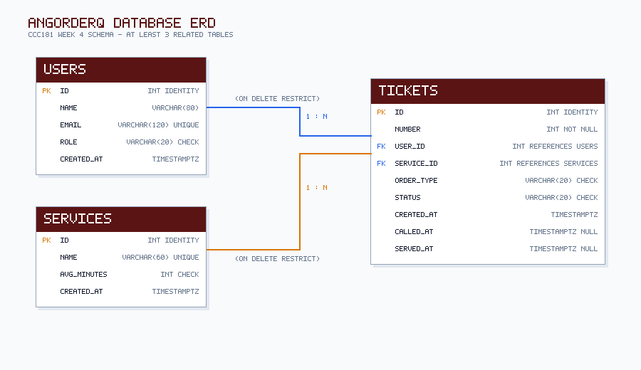
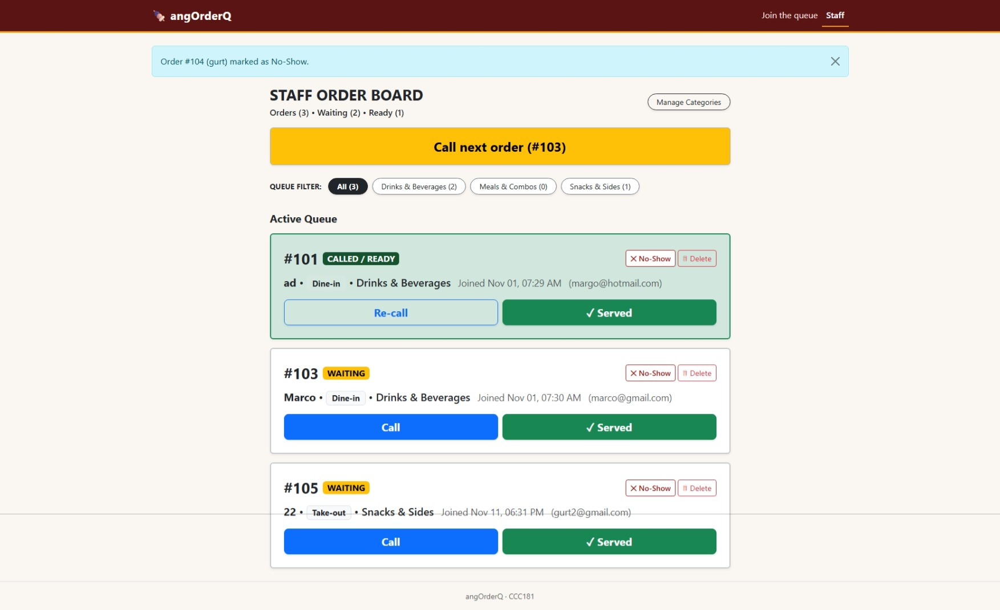
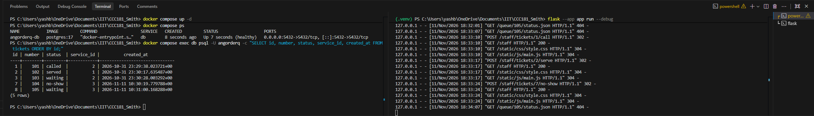
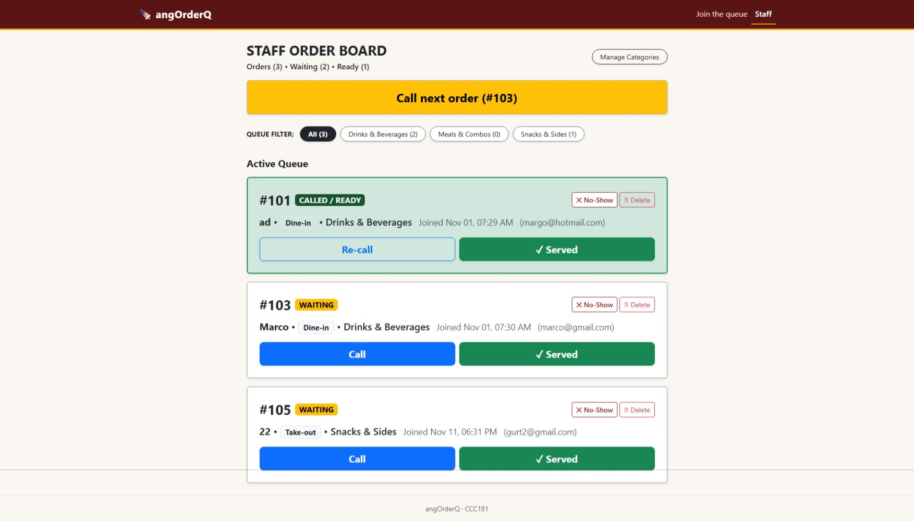
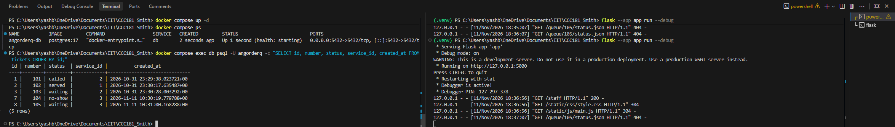

# Week 4 Report: Persistent Database for angOrderQ

## 1. Title Details

- **Application Name:** angOrderQ
- **Setting:** Local food stalls, kiosks, and pop-up food vendors (modeled around *Ate Gina's Food Stall*)
- **Student Name:** Yaseen P. Smith
- **Student ID:** 2024-1729
- **Section:** CS3A
- **Date:** November 11, 2026
- **Pull Request:** [PR #4: Week 4 Database Persistence](https://github.com/ysnsmthiit/CCC181_Smith/pull/4) (Closes Issue #3)
- **Database Architecture:** PostgreSQL 17 running in Docker Compose with named volume persistence (`pgdata`).

---

## 2. Requirements

The living requirements document is maintained at [`docs/requirements.md`](../requirements.md).

- **Functional Requirements:** 12 written, including 4 setting-specific star requirements (★):
  - `FR-08 ★`: Order Type selection (*Dine-in* vs *Take-out*).
  - `FR-09 ★`: Category count pills for kitchen rush monitoring.
  - `FR-10 ★`: Customer profile persistence linking multiple visits to one account.
  - `FR-11 ★`: Audio/visual pulse for re-calling tickets in noisy stall environments.
- **Non-Functional Requirements:** 5 written covering reliability (NFR-01), data integrity (NFR-02), performance (NFR-03), accessibility (NFR-04), and security (NFR-05).
- **MVP Definition:** FR-01, FR-02, FR-03, FR-05, FR-06, FR-07, FR-08, FR-10, NFR-01, NFR-02, NFR-04, NFR-05.
- **Setting Feedback:** A regular student customer at campus food stalls noted: *"I eat at the same food stalls regularly after evening classes. It would be convenient if entering my email recognized me instead of treating me like a brand new visitor every single time, so all my receipts stay connected."* This led directly to creating the `users` table and implementing requirement `FR-10`.

---

## 3. Entity-Relationship Diagram (ERD)

Detailed schema documentation is located at [`docs/week4/schema.md`](schema.md).



### Relationship Reading
- **`users` to `tickets` (1 : N):** One customer can place many ticket orders over time; each ticket belongs to exactly one customer. The foreign key `tickets.user_id` sits on the "many" side.
- **`services` to `tickets` (1 : N):** One food category can categorize many ticket orders; each ticket belongs to exactly one food category. The foreign key `tickets.service_id` sits on the "many" side.

### Foreign Key Delete Rules
- `tickets.user_id` (`ON DELETE RESTRICT`): Deleting a customer record is blocked if they have existing or historical tickets, protecting financial order history.
- `tickets.service_id` (`ON DELETE RESTRICT`): Deleting a food category is blocked if tickets reference it, preventing orphaned sales data.

---

## 4. Database Schema (`\d` Output)

Direct output from PostgreSQL 17 inside the container:

### `users` Table
```
                                       Table "public.users"
   Column   |           Type           | Collation | Nullable |              Default              
------------+--------------------------+-----------+----------+-----------------------------------
 id         | integer                  |           | not null | nextval('users_id_seq'::regclass)
 name       | character varying(80)    |           | not null | 
 email      | character varying(120)   |           | not null | 
 role       | character varying(20)    |           | not null | 'customer'::character varying
 created_at | timestamp with time zone |           | not null | now()
Indexes:
    "users_pkey" PRIMARY KEY, btree (id)
    "users_email_key" UNIQUE CONSTRAINT, btree (email)
Check constraints:
    "ck_users_role" CHECK (role::text = ANY (ARRAY['customer'::character varying, 'staff'::character varying]::text[]))
Referenced by:
    TABLE "tickets" CONSTRAINT "tickets_user_id_fkey" FOREIGN KEY (user_id) REFERENCES users(id) ON DELETE RESTRICT
```

### `services` Table
```
                                       Table "public.services"
   Column    |           Type           | Collation | Nullable |               Default                
-------------+--------------------------+-----------+----------+--------------------------------------
 id          | integer                  |           | not null | nextval('services_id_seq'::regclass)
 name        | character varying(60)    |           | not null | 
 avg_minutes | integer                  |           | not null | 10
 created_at  | timestamp with time zone |           | not null | now()
 active      | boolean                  |           | not null | true
Indexes:
    "services_pkey" PRIMARY KEY, btree (id)
    "services_name_key" UNIQUE CONSTRAINT, btree (name)
Check constraints:
    "ck_services_avg_minutes" CHECK (avg_minutes > 0)
Referenced by:
    TABLE "tickets" CONSTRAINT "tickets_service_id_fkey" FOREIGN KEY (service_id) REFERENCES services(id) ON DELETE RESTRICT
```

### `tickets` Table
```
                                       Table "public.tickets"
   Column   |           Type           | Collation | Nullable |               Default               
------------+--------------------------+-----------+----------+-------------------------------------
 id         | integer                  |           | not null | nextval('tickets_id_seq'::regclass)
 number     | integer                  |           | not null | 
 user_id    | integer                  |           | not null | 
 service_id | integer                  |           | not null | 
 order_type | character varying(20)    |           | not null | 
 status     | character varying(20)    |           | not null | 'waiting'::character varying
 created_at | timestamp with time zone |           | not null | now()
 called_at  | timestamp with time zone |           |          | 
 served_at  | timestamp with time zone |           |          | 
Indexes:
    "tickets_pkey" PRIMARY KEY, btree (id)
Check constraints:
    "ck_tickets_order_type" CHECK (order_type::text = ANY (ARRAY['Dine-in'::character varying, 'Take-out'::character varying]::text[]))
    "ck_tickets_status" CHECK (status::text = ANY (ARRAY['waiting'::character varying, 'called'::character varying, 'served'::character varying, 'no-show'::character varying, 'cancelled'::character varying]::text[]))
Foreign-key constraints:
    "tickets_service_id_fkey" FOREIGN KEY (service_id) REFERENCES services(id) ON DELETE RESTRICT
    "tickets_user_id_fkey" FOREIGN KEY (user_id) REFERENCES users(id) ON DELETE RESTRICT
```

---

## 5. Design Decisions

1. **Customer Normalization into `users` (`FR-10`):** Instead of storing `customer_name` and `email` on every ticket row, customer details live in `users` with a `UNIQUE` constraint on `email`. Repeat customers maintain a unified profile and order history without duplicating records.
2. **Dynamic Position Computation (`FR-02`):** Rather than storing a static queue position column that requires recalculating dozens of database rows every time a ticket is called or leaves, the position in line is computed dynamically using `SELECT COUNT(*) WHERE service_id = t.service_id AND status = 'waiting' AND created_at < t.created_at`.
3. **`ON DELETE RESTRICT` Enforcement:** Foreign keys enforce `RESTRICT` rather than `CASCADE`. If stall staff deactivates or attempts to delete a food category, historical customer tickets referencing that category are protected from accidental mass deletion.

---

## 6. Schema Self-Review

Reviewed in detail in [`docs/week4/schema-review.md`](schema-review.md):
- **Role Constraints:** Added `CHECK (role IN ('customer', 'staff'))` on `users` so staff authorization can be layered in later without modifying the core table structure.
- **Positive Prep Time:** Added `CHECK (avg_minutes > 0)` on `services` to prevent impossible or negative preparation times from entering the database.
- **Timezone Awareness:** Configured all temporal columns as `timestamptz` (`DateTime(timezone=True)`) with server-side `func.now()`, ensuring consistent timestamps regardless of client device timezone differences.

---

## 7. Migrations

All migrations are tracked under `migrations/versions/`:

1. **`a6384fe9a9da_initial_tables.py`:** Generates the initial schema (`users`, `services`, and `tickets` tables) along with identity sequences, primary keys, foreign key constraints, and check constraints.
2. **`3d5ac80b17e8_add_services_active.py`:** Adds the `active` boolean column to `services` with `server_default=sa.text('true')`, allowing staff to switch services off without deleting records.

---

## 8. CRUD Operations

| Operation | Screen & Route | Requirement | Implementation Details |
| --- | --- | --- | --- |
| **Create** | `/join` (`POST /join`) | `FR-01`, `FR-08`, `FR-10` | Finds or creates a `User` profile, assigns next ticket sequence number, and commits `Ticket`. |
| **Read** | `/queue/<id>` & `/staff` | `FR-02`, `FR-04`, `FR-05` | Queries PostgreSQL using SQLAlchemy 2.0 scalars, calculates dynamic position, and renders live status board. |
| **Update** | `/staff` (`POST /staff/tickets/<id>/<action>`) | `FR-06`, `FR-07` | Changes status to `called` or `served` and records database timestamps (`called_at`, `served_at`). |
| **Soft Delete** | `/queue/<id>/leave` & `/staff` | `FR-03`, `FR-07` | Preserves ticket record while transitioning status to `cancelled` or `no-show` for audit reporting. |
| **Hard Delete** | `/staff` (`POST /staff/tickets/<id>/delete`) | Maintenance | Permanently deletes erroneous test tickets using `db.session.delete(t)` after modal confirmation. |

---

## 9. Validation Summary

Detailed logs available in [`docs/week4/validation.md`](validation.md).

- **Browser Layer:** Client HTML attributes (`required`, `type="email"`, `maxlength="80"`) enforce basic input bounds before submission.
- **Flask Layer:** Server-side validation strips whitespace, checks length boundaries, enforces email formatting, validates category existence, and returns `400 Bad Request`.
- **Database Layer:** Engine constraints (`NOT NULL`, `CHECK`, `UNIQUE`, `FOREIGN KEY`, `RESTRICT`) guarantee data integrity even when requests bypass the browser and route layers.
- **Most Useful PostgreSQL Error:** `ERROR: new row for relation "tickets" violates check constraint "ck_tickets_status"`. This proved invaluable because it guarantees that even if application code contained a typo in status naming, the database engine would immediately abort the transaction.
- **SQL Injection Audit:** Ran `git grep -nE 'f".*(SELECT|INSERT|UPDATE|DELETE)' -- "*.py"` with zero matches found. All database queries use SQLAlchemy parameterized expressions.

---

## 10. Persistence & Rebuild Verification

Documented with screenshots in [`docs/week4/persistence.md`](persistence.md).

### The Restart Test (NFR-01)
- Created 5 tickets across multiple food categories, transitioned tickets to `called`, `served`, and `no-show`.
- Captured dashboard and SQL state before shutdown:

  

  

- Stopped Flask and executed `docker compose down`.
- Brought Docker container back up (`docker compose up -d`) and restarted Flask.
- Captured dashboard and SQL state after restart:

  

  

- **Verdict:** **PASSED.** Every ticket number, status, and timestamp persisted with zero data loss.

### Rebuild from Scratch
Tested executing `docker compose down -v`, `docker compose up -d`, `flask --app app db upgrade`, and `flask --app app seed`. The complete database was rebuilt cleanly from migration files and seed data.

---

## 11. Reflection

- **What was hardest this week:** Getting Docker Desktop properly configured on Windows using the WSL 2 backend, ensuring environment variables were cleanly separated in `.env` without entering Git history, and understanding how Alembic manages database migrations when altering existing tables.
- **Hardest requirement to write testably:** Requirement `FR-10` (preserving customer records across visits) because it required verifying both database uniqueness on email lookups and proper foreign key linkage without breaking the existing `/join` user experience.
- **Week 5 Analytics Query:** A vital query that Ate Gina would need is:
  ```sql
  -- Average preparation turnaround time in minutes per food category
  SELECT s.name AS category,
         ROUND(AVG(EXTRACT(EPOCH FROM (t.served_at - t.created_at)) / 60)::numeric, 1) AS avg_turnaround_mins,
         COUNT(t.id) AS total_served
  FROM tickets t
  JOIN services s ON t.service_id = s.id
  WHERE t.status = 'served'
  GROUP BY s.name;
  ```

---

## 12. Declaration

AI coding assistant (Google Antigravity) was consulted as an interactive tutor for syntax clarification, debugging terminal errors, and formatting report tables.
