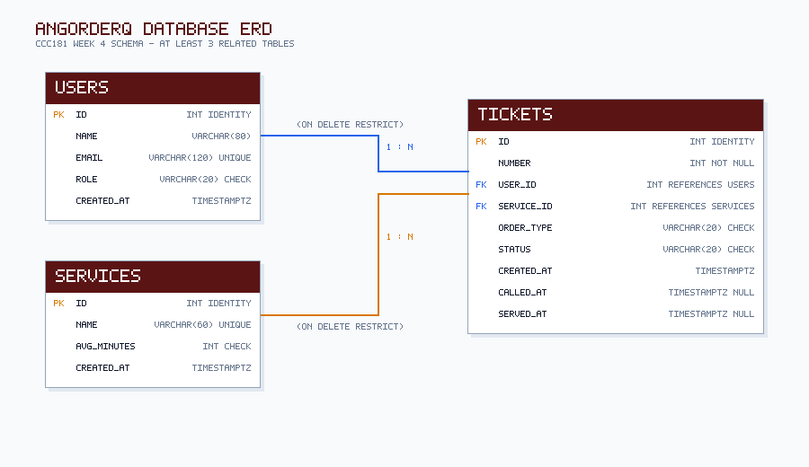
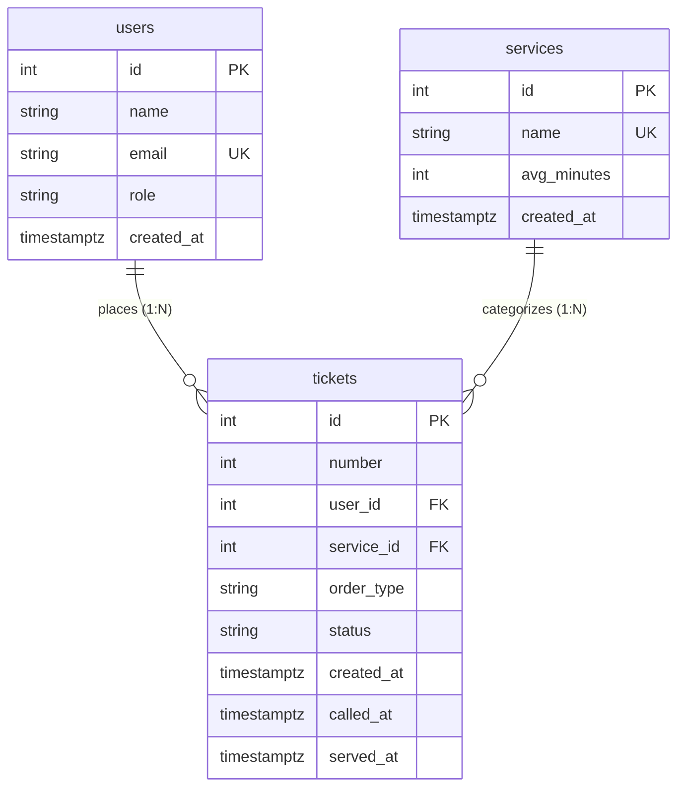

# angOrderQ Database Schema Design & ERD

## Part 2a: Nouns in Requirements

Identified candidate entities and attributes from functional requirements marked **Stores data? = Yes**:

| Req ID | Requirement | Nouns | Table or Column? |
| --- | --- | --- | --- |
| FR-01 | A **customer** can join the **queue** for a **service** by entering their **name**, **email**, and **order type**. | customer, queue, service, name, email, order type | `users`, *(queue is a query)*, `services`, `users.name`, `users.email`, `tickets.order_type` |
| FR-02 | A **customer** can view their **ticket number**, **status**, and count of **orders ahead** of them. | ticket number, status, orders ahead | `tickets.number`, `tickets.status`, *(ahead is computed)* |
| FR-03 | A **customer** can cancel their **order** and leave the **queue** before being called. | order, queue | `tickets` (status transition to 'no-show' or 'cancelled') |
| FR-04 | A **customer** can see a live two-column **claim board** (*Preparing* vs *Now Serving*) with their **ticket** highlighted. | claim board, ticket | *(claim board is computed query)*, `tickets.number` |
| FR-05 | A **stall operator** can view active **tickets** grouped or filtered by **food category** (*Meals & Combos*, *Drinks*, *Snacks*). | stall operator, tickets, food category | `users` (role='staff'), `tickets`, `services` |
| FR-06 | A **stall operator** can call the next waiting **order**, transitioning its **status** to `called` with a recorded **timestamp**. | order, status, timestamp | `tickets`, `tickets.status`, `tickets.called_at` |
| FR-07 | A **stall operator** can mark a called **ticket** as `served` or flag it as `no-show` with a recorded **timestamp**. | ticket, timestamp | `tickets`, `tickets.status`, `tickets.served_at` |
| FR-08 ★ | A **customer** can specify an **Order Type** (*Dine-in* vs *Take-out*) so kitchen staff package the food appropriately. | customer, Order Type | `users`, `tickets.order_type` |
| FR-09 ★ | A **stall operator** can view live count **pills** showing active waiting **orders** per **food category**. | pills, orders, food category | *(count pills are computed aggregate queries)*, `tickets`, `services` |
| FR-10 ★ | A **customer's** contact profile (**name** and **email**) is preserved in a **user/customer record**, linking multiple **ticket orders** to the same customer. | customer, name, email, record, ticket orders | `users.name`, `users.email`, `users` (table), `tickets` (table) |
| FR-11 ★ | A **stall operator** can re-call a **ticket** with an audio/visual pulse if the customer did not hear their number in noisy stall conditions. | ticket | `tickets` |
| FR-12 | A **stall operator** can add, rename, or toggle availability of a **food service category**. | food service category | `services` |

> **Key Design Principles Applied:**
> 1. *The queue is not a table:* The active queue is dynamically queried as tickets with `status IN ('waiting', 'called')` ordered by `created_at` ASC.
> 2. *Store facts, not results:* Queue position ("orders ahead") and category wait counts are computed on demand from timestamps and status filters rather than stored statically.

---

## Part 2b: List of Tables and Columns

The system consists of **3 related tables**:

1. **`users` (Customers and Stall Staff):**
   - Stores identity and contact information for people interacting with the stall.
   - Preserves repeat customer profiles across multiple visits and supports staff role authorization.
   - Columns: `id`, `name`, `email`, `role`, `created_at`.

2. **`services` (Food Categories / Service Lines):**
   - Represents the menu offerings and preparation lanes available at the stall (*Meals & Combos*, *Drinks & Beverages*, *Snacks & Sides*).
   - Columns: `id`, `name`, `avg_minutes`, `created_at`.

3. **`tickets` (Order Queue Tickets):**
   - Represents an individual customer visit and food order event.
   - Links the customer to their chosen food category, records the packaging preference (`order_type`), and tracks lifecycle timestamps.
   - Columns: `id`, `number`, `user_id`, `service_id`, `order_type`, `status`, `created_at`, `called_at`, `served_at`.

---

## Part 2c: Types and Constraints

| Table | Column | PostgreSQL Type | Constraint | Why |
| --- | --- | --- | --- | --- |
| `users` | `id` | `integer` | `PRIMARY KEY GENERATED ALWAYS AS IDENTITY` | Unique immutable surrogate identifier managed by PostgreSQL. |
| `users` | `name` | `varchar(80)` | `NOT NULL` | A customer nickname or staff name is always required for visual order calling. |
| `users` | `email` | `varchar(120)` | `NOT NULL UNIQUE` | Uniquely identifies repeat customer profiles and prevents duplicate contact records. |
| `users` | `role` | `varchar(20)` | `NOT NULL DEFAULT 'customer' CHECK (role IN ('customer', 'staff'))` | Restricts accounts to supported authorization roles. |
| `users` | `created_at` | `timestamptz` | `NOT NULL DEFAULT now()` | Accurate timezone-aware timestamp of when user joined system. |
| `services` | `id` | `integer` | `PRIMARY KEY GENERATED ALWAYS AS IDENTITY` | Unique immutable category key. |
| `services` | `name` | `varchar(60)` | `NOT NULL UNIQUE` | Category names must be distinct to prevent duplicate menu options. |
| `services` | `avg_minutes` | `integer` | `NOT NULL DEFAULT 10 CHECK (avg_minutes > 0)` | Expected preparation time; CHECK prevents zero or negative estimates. |
| `services` | `created_at` | `timestamptz` | `NOT NULL DEFAULT now()` | Timestamp when service line was registered. |
| `tickets` | `id` | `integer` | `PRIMARY KEY GENERATED ALWAYS AS IDENTITY` | Unique immutable database row identifier. |
| `tickets` | `number` | `integer` | `NOT NULL` | Daily sequence ticket number displayed to customer and shouted by staff (e.g. 101, 102). |
| `tickets` | `user_id` | `integer` | `NOT NULL REFERENCES users(id) ON DELETE RESTRICT` | Foreign key linking ticket to customer profile; RESTRICT prevents accidental deletion of active customer orders. |
| `tickets` | `service_id` | `integer` | `NOT NULL REFERENCES services(id) ON DELETE RESTRICT` | Foreign key linking ticket to menu category; RESTRICT prevents deleting categories with pending tickets. |
| `tickets` | `order_type` | `varchar(20)` | `NOT NULL CHECK (order_type IN ('Dine-in', 'Take-out'))` | Enforces valid food packaging options specific to the stall setting. |
| `tickets` | `status` | `varchar(20)` | `NOT NULL DEFAULT 'waiting' CHECK (status IN ('waiting', 'called', 'served', 'no-show', 'cancelled'))` | Enforces the finite state machine transitions for queue lifecycle. |
| `tickets` | `created_at` | `timestamptz` | `NOT NULL DEFAULT now()` | Timezone-aware timestamp when customer joined queue; determines queue ordering. |
| `tickets` | `called_at` | `timestamptz` | `NULL` | Timezone-aware timestamp recorded when stall operator calls order for pickup. |
| `tickets` | `served_at` | `timestamptz` | `NULL` | Timezone-aware timestamp recorded when meal is handed over or completed. |

---

## Part 2d: Entity-Relationship Diagram (ERD)

### Relationship Reading
- **`users` to `tickets` (1 : N):** One customer can place many ticket orders over time; each ticket belongs to exactly one customer. The foreign key `tickets.user_id` sits on the "many" side.
- **`services` to `tickets` (1 : N):** One food category can categorize many ticket orders; each ticket belongs to exactly one food category. The foreign key `tickets.service_id` sits on the "many" side.

### Foreign Key Delete Rules
- **`tickets.user_id` (`ON DELETE RESTRICT`):** Deleting a user profile is blocked if existing ticket orders refer to it. This preserves the operational audit trail and historical queue logs for stall analytics.
- **`tickets.service_id` (`ON DELETE RESTRICT`):** Deleting a food category is blocked if tickets currently or previously used that category. Stall staff can toggle availability instead of deleting referenced records.

---

## Part 2e: Normalization Assessment

1. **First Normal Form (1NF) — One value per cell:**  
   *Yes.* Every attribute holds a single, atomic value. No lists, arrays, or concatenated strings (such as combined dish lists) are stored in any column.
2. **Second Normal Form (2NF) — Depends on the whole key:**  
   *Yes.* All non-key attributes in `users`, `services`, and `tickets` depend entirely on their respective single-column surrogate primary keys (`id`). There are no partial composite key dependencies.
3. **Third Normal Form (3NF) — No hidden copies / transitive dependencies:**  
   *Yes.* Non-key attributes do not depend on other non-key attributes. Customer name and email live exclusively in `users`; food category names live exclusively in `services`. The `tickets` table only stores foreign key pointers, eliminating redundant copies of user or service data.

